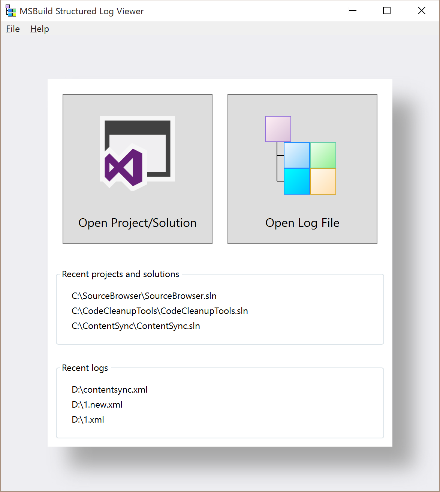

# MSBuildStructuredLog
A logger for MSBuild that records a structured representation of executed targets, tasks, property and item values. It can greatly simplify build investigations and provides a portable log interchange format (*.binlog) and a rich interactive log viewer app.

[](https://ci.appveyor.com/project/KirillOsenkov/msbuildstructuredlog)
[](https://nuget.org/packages/MSBuild.StructuredLogger)
[](https://nuget.org/packages/MSBuild.StructuredLogger.Utils) (optional)
[](https://chocolatey.org/packages/msbuild-structured-log-viewer)

Homepage: https://msbuildlog.com
BinlogMcp: https://msbuildlog.com/binlogmcp
Syntax: https://msbuildlog.com/syntax

Thanks to [SignPath.io](https://signpath.io?utm_source=foundation&utm_medium=github&utm_campaign=MSBuildStructuredLog) for providing a free code signing service and to the [SignPath Foundation](https://signpath.org?utm_source=foundation&utm_medium=github&utm_campaign=MSBuildStructuredLog) for a free code signing certificate to sign the installer.

## Install:
Install from https://msbuildlog.com.

The app updates automatically via [Squirrel](https://github.com/Squirrel/Squirrel.Windows) (after launch it checks for updates in background), next launch starts the newly downloaded latest version.


## Installing the Avalonia version on Mac:

Download the latest release for [arm64](https://github.com/KirillOsenkov/MSBuildStructuredLog/releases/latest/download/StructuredLogViewer-arm64.dmg) or [x64](https://github.com/KirillOsenkov/MSBuildStructuredLog/releases/latest/download/StructuredLogViewer-x64.dmg).

Alternatively, you can install from Homebrew:

```
brew install structuredlogviewer
```

## Building & Running the Avalonia version on Mac/Linux:

```
git clone https://github.com/KirillOsenkov/MSBuildStructuredLog
cd MSBuildStructuredLog
./run.sh
```

Alternatively, a longer version:

1. `dotnet build MSBuildStructuredLog.Avalonia.sln`
2. `dotnet publish MSBuildStructuredLog.Avalonia.sln --self-contained -o <some_dir>` (I used $HOME/tools/artifacts/StructuredLogViewer.Avalonia)
3. make a script `$HOME/bin/structured-log-viewer` (or whatever's on your PATH):

```
#! /bin/sh
exec dotnet ${HOME}/tools/artifacts/StructuredLogViewer.Avalonia/publish/StructuredLogViewer.Avalonia.dll "$@"
```

## Requirements:

Windows:
 * .NET Framework 4.7.2
 * MSBuild 17.0
 * Visual Studio 2022

Mac:
 * .NET SDK

## Usage:

You can pass `/bl` switch to `msbuild.exe` or `dotnet build` to record a binary build log to `msbuild.binlog`, in the same folder as the project/solution being built:


or you can build the solution or open an existing log file through the viewer app:



## Features:

 * Preprocess project files (with all imports inlined), right-click on a project -> Preprocess
 * If a log has embedded files, you can view the list of files, full-text search in all files, and use the Space key (or double-click) on most nodes to view the source code.
 * When you switch between the Search Log, Properties and items, Files and Find in Files tabs, the search text of the previous tab is copied to the selected tab if its search box is empty. Text that matches no file is not copied to the Files tab. Search Log, Properties and items, and Find in Files each have a separate list of recent searches.
 * Use Copy navigation path/Paste navigation path in the tree and breadcrumb context menus, or Ctrl+Shift+C/Ctrl+Shift+V, to navigate to the corresponding node in another log. Click anywhere in the breadcrumb area to focus these shortcuts. Standard Ctrl+C still copies tree-node text. Paths ignore build filenames, timings, IDs, and property values. Project paths and node ancestry must match; missing or ambiguous matches are reported instead of guessed.
 * Displays [double-writes](https://github.com/KirillOsenkov/MSBuildStructuredLog/wiki/Double%20write%20detection) (when files from different sources are written to the same destination during a build, thus causing non-determinism)
 * Displays target dependencies for each target
 * Narrow down the search results using the under() or project() clauses to only display results under a certain parent or project.
 * Each node in the tree has a context menu. Ctrl+C to copy an item and the entire subtree to Clipboard as text.
 * Delete to hide nodes from the tree (to get uninteresting stuff out of the way).
 * Open and save log files (option to save log files to .xml)
 * Logs can include the source code project files and all imported files used during the build.

## Investigating problems with MSBuildStructuredLog

Open an issue if you're running into something weird and I can take a look into it. If MSBuildStructuredLog crashes during the build, it will attempt to write the exception call stack to:

```
%localappdata%\Microsoft\MSBuildStructuredLog\LoggerExceptions.txt
```

## MSBuild Resources
 * [https://msbuildlog.com](https://msbuildlog.com)
 * [https://github.com/dotnet/msbuild/blob/main/documentation/wiki/MSBuild-Resources.md](https://github.com/dotnet/msbuild/blob/main/documentation/wiki/MSBuild-Resources.md)
 * [https://github.com/dotnet/msbuild/blob/main/documentation/wiki/MSBuild-Tips-&-Tricks.md](https://github.com/dotnet/msbuild/blob/main/documentation/wiki/MSBuild-Tips-&-Tricks.md)
